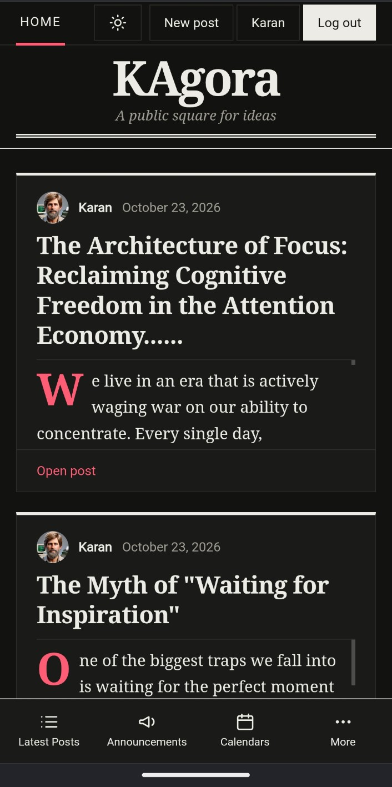

# KAgora

KAgora is a small blogging and discussion application built around the idea of
a public square for sharing ideas and posts.

## What it includes

- User registration and login
- JWT-based authentication
- Create, edit, and delete posts
- Profile management and profile pictures
- Password reset by email
- SQLite or PostgreSQL database support
- Optional Amazon S3-compatible image storage
- Light and dark themes
- Responsive layout and installable app icons

## Technology

- Python 3.13+
- FastAPI
- SQLAlchemy and Alembic
- Jinja templates
- Vanilla JavaScript and CSS
- SQLite or PostgreSQL
- Amazon S3-compatible storage for profile pictures

## Run locally

1. Install [uv](https://docs.astral.sh/uv/).
2. Install the project dependencies:

   ```powershell
   uv sync
   ```

3. Create a `.env` file in the project root. At minimum, configure:

   ```text
   DATABASE_URL=sqlite+aiosqlite:///./fastapi_blog.db
   SECRET_KEY=replace-this-with-a-long-random-secret
   S3_BUCKET_NAME=your-bucket-name
   ```

   Add the mail and S3 credentials needed by the features you want to use.

4. Apply database migrations:

   ```powershell
   uv run alembic upgrade head
   ```

5. Start the development server:

   ```powershell
   uv run fastapi dev src/kagora/main.py
   ```

Then open `http://localhost:8000`.

## See KAgora in action

Here is a quick look at the KAgora home page running locally:



## Closing note

KAgora is built to keep conversations open, personal, and easy to share.